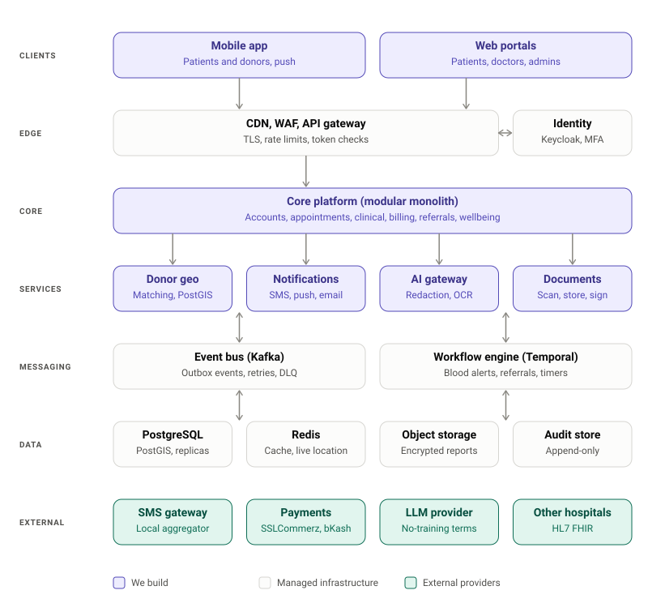
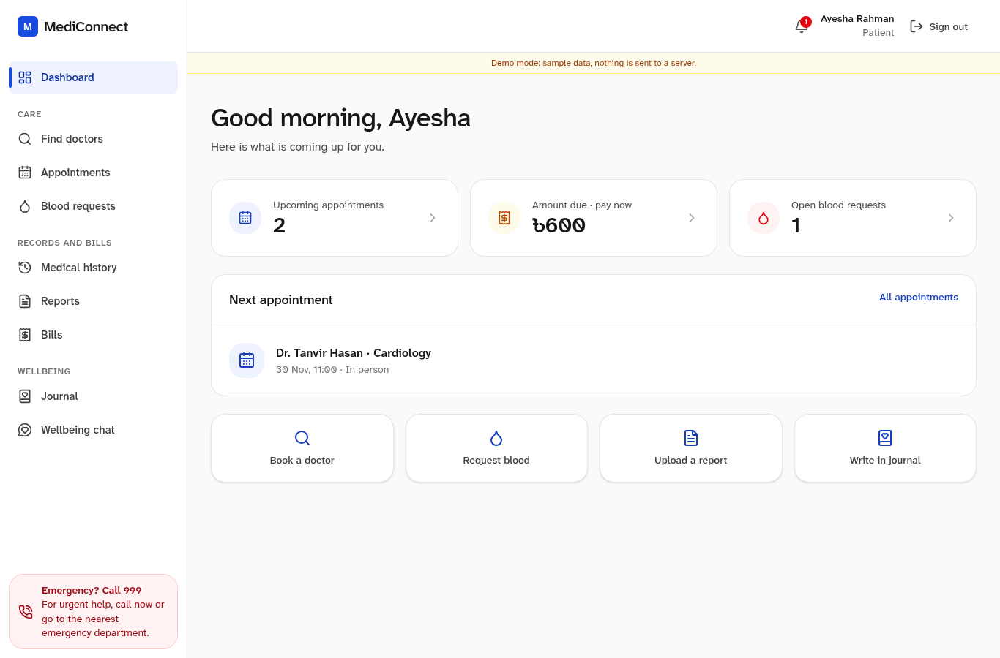
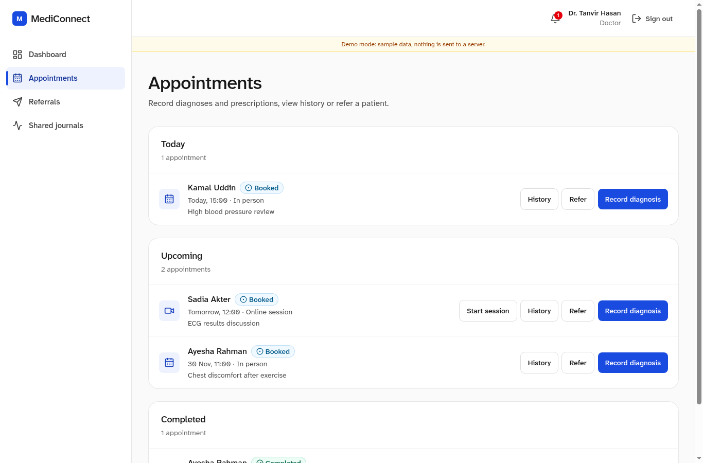
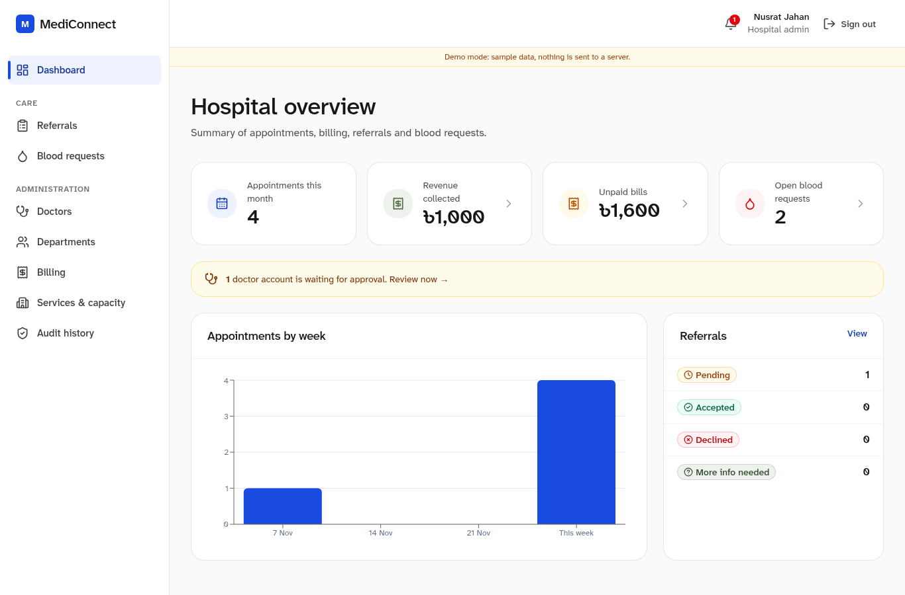
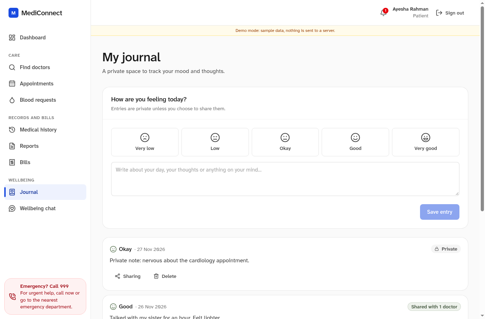
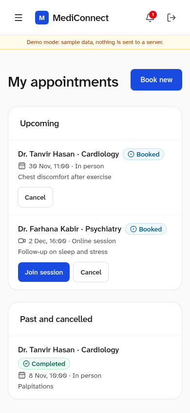

<p align="center">
  
</p>

**AI-Assisted E-Healthcare Management System with Referral Coordination, Blood Donor Finder and Mental Wellbeing Support**

<p align="center">
  
  
  
</p>

<p align="center">
  
  
  
  
  
  
  
  
  
  
  
  
  
  
  
  
</p>

MediConnect is a web and mobile platform that manages the daily work of a hospital or clinic online. Patients book appointments, doctors record diagnoses and prescriptions, and hospital admins manage doctors, bills and reports. Beyond the core hospital workflow, the system:

- **coordinates referrals between hospitals** and automatically transfers the patient's medical reports when a referral is accepted,
- **finds nearby blood donors quickly** while keeping every donor's location private, and
- **supports mental wellbeing** with a private journal, mood trends and an AI chatbot.

> **Current state of this repository:** it holds the **web frontend** (React, in `frontend/`) and a static landing page. The frontend runs fully on its own in **mock mode**, where an in-browser fake API with demo data stands in for the backend. The Spring Boot backend, `docker-compose.yml`, `pom.xml` and the SRS document described below are not committed yet; the mock API in `frontend/src/mock/server.ts` is the REST contract the backend must implement.

---

## Table of Contents

- [Features](#features)
- [User Roles](#user-roles)
- [Tech Stack](#tech-stack)
- [Architecture](#architecture)
- [Project Structure](#project-structure)
- [Getting Started](#getting-started)
- [Configuration](#configuration)
- [Running Tests](#running-tests)
- [OOP Design Highlights](#oop-design-highlights)
- [Security and Privacy](#security-and-privacy)
- [Documentation](#documentation)
- [Screenshots](#screenshots)
- [Contributing](#contributing)
- [Author](#author)
- [License](#license)

---

## Features

### Accounts and access
- Registration for patients, donors, doctors and hospitals
- Doctor accounts stay **Pending** until a hospital admin approves them
- Role-based login and role-based menus; access is checked on the server for every request

### Appointments and clinical records
- Search doctors by name, specialty or department
- Book in-person appointments or online sessions (meeting link attached to the appointment); only the doctor's free, future time slots can be booked, and a slot cannot be booked twice
- Doctors record diagnoses and prescriptions, which are stored in the patient's medical history
- Medical history is visible only to the patient and the treating doctor

### Billing and payments
- Hospital admins create bills for appointments
- Patients view and pay bills (cash, card through SSLCommerz, mobile payment through bKash)
- Card and bKash bills are marked paid only when the payment gateway confirms; cash bills stay unpaid until staff mark them paid at the counter
- New payment methods plug in through a common `PaymentMethod` interface

### Medical reports
- Upload digital copies (PDF, JPG, PNG) of physical reports
- AI-generated short summary of the key findings, shown with the report
- Reports are still stored and shown when the AI summary is unavailable
- Automatic transfer of reports to the receiving hospital (over HL7 FHIR) when a referral is accepted, or manual sending by the patient at any time

### Hospital referral coordination
- Hospitals maintain their services, capacity status (**Available / Limited / Unconfirmed**) and whether they accept referrals
- Doctors search hospitals by location and required service and send referral requests
- Referral tracking: **Pending, Accepted, Declined, More Information Needed**
- Alternative hospitals suggested (by service, capacity and distance) when a referral is not accepted

### Blood donor finder
- Patients and hospital admins post blood requests (blood group, units, location)
- Matching by availability, blood group compatibility, distance and recovery period
- Ranked donors are notified by push, SMS and email; automatic reminders (configurable count and window) stop when a donor accepts
- **Donor locations are never shown to any user**
- Donors set themselves Active or Inactive; they become Inactive automatically after a confirmed donation until the recovery period ends

### Mental wellbeing support
- Private daily journal with a 1 to 5 mood scale
- Patients choose which entries to share with which doctor
- Mood trend chart of the shared entries for the doctor
- AI chatbot for talking about feelings, common questions and general health tips, which encourages contacting a doctor or helpline when it detects signs of serious distress
- Online sessions with mental health doctors

### Administration and audit
- Manage doctors and departments (a doctor with booked appointments cannot be removed until those are moved or cancelled)
- Summary dashboard for appointments, billing, referrals and blood requests, computed from live data
- Insert-only audit history of who changed what and when

### Accessibility and usability
Built for people who may be unwell, older, anxious or on a phone:

- **Atkinson Hyperlegible Next**, a typeface drawn for low-vision readers, with Hind Siliguri for Bangla; no text smaller than 14px for body content
- Every status (Booked, Paid, Pending, Declined and so on) shows an **icon and a word**, never colour alone
- Required fields are marked, errors appear next to the field with an icon, and buttons are at least 44px tall on touch screens
- Full keyboard use with visible focus; dialogs use the native `<dialog>`; motion is turned off for users who ask for reduced motion
- Patients and donors always see an **"Emergency? Call 999"** link in the menu
- Dates near today read "Today, 15:00" or "Tomorrow, 12:00"; dashboard figures link to the page where you act on them
- Menus are grouped (Care, Records and bills, Wellbeing, Administration), and lists stack cleanly on phones
- Confirmation steps use the app's own dialog instead of the browser's pop-up

### AI assistance (assistive only)
AI is used for exactly four functions: **report summaries, donor ranking, mood trend analysis and the chatbot**. It never makes a diagnosis or a medical decision, and the system keeps working when the AI service is unavailable.

---

## User Roles

| Role | Main actions |
|------|--------------|
| **Patient** | Book appointments and online sessions, view medical history and bills, pay bills, upload and send reports, post blood requests, write a journal, chat with the chatbot |
| **Donor** | Receive and answer blood requests, set Active or Inactive status |
| **Doctor** | View appointments, record diagnoses and prescriptions, view reports, send referrals, view shared journal entries, conduct online sessions |
| **Hospital Admin** | Approve doctors, manage doctors and departments, create bills, maintain services and capacity, respond to referrals, post blood requests, confirm donations, view reports and audit history |

---

## Tech Stack

| Layer | Technology |
|-------|------------|
| Language | Java 17+ |
| Backend | Spring Boot, Spring Web (REST) |
| Persistence | Spring Data JPA, Hibernate |
| Identity and security | Keycloak (OIDC, MFA), Spring Security OAuth2 resource server |
| Edge | CDN, WAF, API gateway (TLS, rate limits, token checks) |
| Validation | Jakarta Bean Validation |
| Messaging | Apache Kafka (transactional outbox, retries, dead-letter queue) |
| Workflows | Temporal (blood alerts, referrals, timers) |
| Notifications | Push, SMS (local aggregator), Spring Mail |
| AI integration | AI gateway service (redaction, OCR) behind the `AiService` interface |
| Payments | SSLCommerz, bKash |
| Interoperability | HL7 FHIR (report exchange with other hospitals) |
| Web frontend | React 19, TypeScript 7, Vite 8, React Router |
| UI components | Tailwind CSS 4 with small in-house accessible components (native `<dialog>`, labelled fields), lucide icons, sonner toasts, Atkinson Hyperlegible Next |
| Frontend data and forms | TanStack Query (server state), React Hook Form + Zod (validation) |
| Frontend features | Recharts (mood trend, reports), oidc-client-ts (Keycloak login), react-i18next (English now; Bangla once every page is translated) |
| Frontend testing | Vitest, React Testing Library, oxlint; GitHub Actions CI |
| Mobile app | Patients and donors, push notifications, device location |
| Database | PostgreSQL 16 with PostGIS, read replicas |
| Cache | Redis (cache, live donor location) |
| File storage | S3-compatible object storage (encrypted reports) |
| Audit | Append-only audit store |
| Build and local infra | Maven, Docker Compose |
| Testing | JUnit 5, Mockito, Spring Boot Test |

---

## Architecture



Web portals and the mobile app reach the system through a CDN, WAF and API gateway, with Keycloak handling identity and MFA. A core **modular monolith** (accounts, appointments, clinical, billing, referrals, wellbeing) runs alongside four extracted services: donor geo matching, notifications, the AI gateway and documents. Kafka carries events, and Temporal runs long-lived workflows such as blood alerts, referrals and timers. Data lives in PostgreSQL with PostGIS, Redis, encrypted object storage and an append-only audit store. External providers are an SMS gateway, payments (SSLCommerz, bKash), an LLM provider and other hospitals over HL7 FHIR.

Inside the core, each layer only calls the layer below it, and controllers never access repositories directly.

---

## Project Structure

```
mediconnect-ehms/
├── .github/workflows/
│   └── frontend.yml             # CI: typecheck, tests, lint and build for the frontend
├── docs/
│   ├── screenshots/             # screenshots used in this README
│   └── SRS_E-Healthcare_Management_System_v1.1.docx   # (not committed yet)
├── frontend/                    # React + TypeScript web portals (Vite)
│   ├── index.html               # static landing page at "/"
│   ├── app.html                 # entry for the React app (every other route)
│   ├── public/assets/           # the landing page's design kit (CSS, scripts, UI fragments)
│   ├── src/
│   │   ├── app/                 # router, providers, query client
│   │   ├── api/                 # API client and TypeScript types mirroring the Java DTOs
│   │   ├── auth/                # Keycloak login, demo login and role-based route guard
│   │   ├── components/          # shared UI components (button, dialog, form, badge, table) and page blocks
│   │   ├── features/            # one folder per module: account, appointments, clinical, billing,
│   │   │                        #   reports, referrals, blood, wellbeing, notifications, admin
│   │   ├── hooks/               # useAction (mutation + toast), useConfirm (confirmation dialog)
│   │   ├── layouts/             # app shell with grouped, role-based navigation
│   │   ├── lib/                 # date, money and mood helpers
│   │   ├── mock/                # in-browser fake API and demo data (also the REST contract and its tests)
│   │   ├── i18n/                # English and Bangla translations
│   │   └── main.tsx
│   ├── .env.example             # VITE_API_MODE=mock | live, Keycloak settings
│   ├── package.json
│   └── vite.config.ts           # dev proxy: /api → http://localhost:8080
├── src/                         # Spring Boot backend (Java) — not committed yet
│   ├── main/
│   │   ├── java/com/mediconnect/
│   │   │   ├── config/          # security, scheduling, application settings
│   │   │   ├── account/         # users, registration, approval, login
│   │   │   ├── appointment/     # appointments and online sessions
│   │   │   ├── clinical/        # diagnoses, prescriptions, medical history
│   │   │   ├── billing/         # bills, payments, PaymentMethod implementations
│   │   │   ├── report/          # medical reports, report transfers
│   │   │   ├── referral/        # hospital services, capacity, referrals
│   │   │   ├── blood/           # donors, blood requests, matching, reminders
│   │   │   ├── wellbeing/       # journal, sharing, chatbot, mood trend
│   │   │   ├── admin/           # departments, summary reports
│   │   │   ├── notification/    # shared notification service and channels
│   │   │   ├── audit/           # shared audit service
│   │   │   └── ai/              # AiService interface and implementations
│   │   └── resources/
│   │       └── application.properties
│   └── test/java/com/mediconnect/
├── .gitignore
├── docker-compose.yml           # PostgreSQL, Redis, Kafka, Temporal, Keycloak, object storage (not committed yet)
├── mediconnect_production_architecture.svg
├── pom.xml                      # (not committed yet)
└── README.md
```

The backend is Java and Spring Boot; the frontend is a separate React app that talks to it only through the REST API (JSON over HTTPS). Each backend module contains its own `controller`, `service`, `repository`, `entity` and `dto` classes. The `blood` (donor geo matching), `notification`, `ai` and `report` (documents) modules are the ones deployed as separate services in production; they talk to the core through Kafka events and Temporal workflows.

---

## Getting Started

### Prerequisites

- JDK 17 or newer
- Maven 3.9+ (or use the included Maven wrapper `./mvnw`)
- Node.js 22 LTS or newer, with npm (for the React frontend; CI uses Node 26)
- Docker and Docker Compose (runs PostgreSQL with PostGIS, Redis, Kafka, Temporal, Keycloak and object storage locally)
- Git

### 1. Clone the repository

```bash
git clone https://github.com/<your-username>/mediconnect-ehms.git
cd mediconnect-ehms
```

### 2. Set environment variables

Secrets are read from environment variables and are never committed.

```bash
export DB_USERNAME=mediconnect
export DB_PASSWORD=change-me
export STORAGE_ACCESS_KEY=change-me
export STORAGE_SECRET_KEY=change-me
export MAIL_USERNAME=you@example.com
export MAIL_PASSWORD=your-app-password
export SMS_API_KEY=your-sms-api-key    # optional in development
export AI_API_KEY=your-ai-api-key      # optional, see AI mode below
```

On Windows PowerShell use `$env:DB_USERNAME="mediconnect"` and so on.

### 3. Start the infrastructure

```bash
docker compose up -d
```

This starts PostgreSQL with PostGIS, Redis, Kafka, Temporal, Keycloak and an S3-compatible object store. The database is created on first start with the credentials above.

### 4. Run the backend

```bash
./mvnw spring-boot:run
```

The REST API runs on **http://localhost:8080**.

### 5. Run the frontend

In a second terminal:

```bash
cd frontend
npm install
npm run dev
```

Then open **http://localhost:5173** in your browser.

The frontend has two modes, set with `VITE_API_MODE` in `frontend/.env` (copy it from `.env.example`):

- **`mock`** (default): the whole UI runs on built-in sample data with a demo login for each role (patient, doctor, donor, hospital admin). No backend, database or Keycloak is needed, so you can start the frontend on its own (skip steps 3 and 4). Demo data is kept in the browser's local storage; clear site data to start fresh.
- **`live`**: requests go to the Spring Boot API, and users sign in through Keycloak. The Vite dev server forwards `/api` to the backend on port 8080, so no CORS setup is needed during development.

The REST endpoints the backend must provide are listed in `frontend/src/mock/server.ts`.

For production, `npm run build` creates static files in `frontend/dist/`, which are served from the CDN in front of the API gateway. The host must serve `index.html` (the landing page) at `/` and **`app.html` for every other path that is not a file**, so links such as `/patient/bills` open the app directly.

---

## Configuration

Configurable values live in `src/main/resources/application.properties`, not in the code. The `app.*` keys below are the project's own settings.

```properties
# Database
spring.datasource.url=jdbc:postgresql://localhost:5432/mediconnect
spring.datasource.username=${DB_USERNAME}
spring.datasource.password=${DB_PASSWORD}
spring.jpa.hibernate.ddl-auto=update

# Identity (Keycloak)
spring.security.oauth2.resourceserver.jwt.issuer-uri=http://localhost:8180/realms/mediconnect

# Cache
spring.data.redis.host=localhost
spring.data.redis.port=6379

# Messaging and workflows
spring.kafka.bootstrap-servers=localhost:9092
app.temporal.target=localhost:7233

# File uploads (encrypted object storage)
spring.servlet.multipart.max-file-size=10MB
app.reports.storage.endpoint=http://localhost:9000
app.reports.storage.bucket=mediconnect-reports
app.reports.storage.access-key=${STORAGE_ACCESS_KEY}
app.reports.storage.secret-key=${STORAGE_SECRET_KEY}
app.reports.allowed-types=application/pdf,image/jpeg,image/png

# SMS gateway
app.sms.api-key=${SMS_API_KEY:}

# Blood donor finder
app.blood.reminder.max-count=4
app.blood.reminder.window-minutes=20
app.blood.match.max-distance-km=10
app.blood.recovery-period-days=90

# AI service: "mock" returns sample results, "external" calls the real provider
app.ai.mode=mock
app.ai.api-key=${AI_API_KEY:}
app.ai.timeout-seconds=15

# Email
spring.mail.host=smtp.gmail.com
spring.mail.port=587
spring.mail.username=${MAIL_USERNAME}
spring.mail.password=${MAIL_PASSWORD}
```

> **AI mode:** keep `app.ai.mode=mock` during development and demos so the app never depends on an external API. Switch to `external` once a provider is connected.

> **Recovery period:** the value above is a placeholder. Set it according to hospital policy.

---

## Running Tests

```bash
./mvnw test
```

Unit tests cover the core business rules without the database or the AI service, for example:

- blood group compatibility and donor eligibility
- reminder limits and stopping reminders on acceptance
- preventing double booking of a doctor
- bill status updates after payment
- role-based access to medical history, reports and journal entries

Frontend checks (the same ones CI runs on every pull request):

```bash
cd frontend
npm test            # Vitest: components, forms, role-based routes, date helpers and the API business rules
npm run typecheck
npm run lint
npm run build
```

The API business-rule tests in `src/mock/server.test.ts` (ownership checks, no double booking, one answer per donor, cash bills, booking rules) run against the mock by default. To check the real backend against the same rules, seed it with the demo data, expose a test-only `POST /test/reset`, and run:

```bash
API_URL=http://localhost:8080/api API_TOKENS='{"p1":"<token>","p2":"<token>","d1":"<token>","d9":"<token>","n1":"<token>","a1":"<token>"}' npx vitest run src/mock/server.test.ts
```

---

## OOP Design Highlights

| Concept | Where it is used |
|---------|------------------|
| **Abstraction and inheritance** | Abstract `User` → `Patient`, `Doctor`, `Donor`, `HospitalAdmin`; `Appointment` → `OnlineSession` |
| **Interfaces (Strategy pattern)** | `PaymentMethod` (Cash, Card, Mobile), `MatchingStrategy` (donor matching), `AiService` (AI provider), `NotificationChannel` (in-app, push, SMS, email) |
| **Encapsulation** | Donor latitude and longitude are private and used only for matching |
| **Composition** | `Bill` → `Payment`, `MedicalRecord` → `Prescription`, `BloodRequest` → `DonorResponse` |
| **Aggregation** | `Hospital` → `Department`, `Doctor`, `HospitalAdmin` |
| **Open/closed principle** | New payment methods, matching rules, AI providers and notification channels are added without changing existing code |

---

## Security and Privacy

- Login, passwords and MFA handled by Keycloak; the application never stores passwords
- Role-based access control enforced on the server for every request, using Keycloak tokens checked at the API gateway and in each service
- TLS at the edge, with a WAF and rate limits in front of the API gateway
- API responses use DTOs, so **donor locations, private journal entries and other users' reports are never returned**
- Live donor locations are kept only in Redis for matching and are never exposed through any API
- Medical reports are encrypted in object storage and accessible only to the patient, the treating doctor and the receiving hospital
- Audit history is written to an append-only audit store
- Access tokens are short-lived and sessions expire after inactivity
- Input validation and parameterized queries against injection
- The AI gateway redacts personal data before anything reaches the LLM provider, which is used under no-training terms

---

## Documentation

The full **Software Requirements Specification (v1.1)** is in [`docs/`](docs/). It contains the functional and non-functional requirements, use case, activity and sequence diagrams, the class diagram, the ER design, the system architecture and the design assumptions.

---

## Screenshots

Taken in mock mode with the built-in demo data (all names are fictional).

**Patient dashboard** — key figures link to where you act on them; the emergency line stays in the menu.



**Doctor's appointments** — today and upcoming visits with history, referral and diagnosis actions.



**Hospital overview** — appointments, revenue, open blood requests and referral status for the admin.



**Mood journal** — private entries on a 1 to 5 scale, shared only with the doctors the patient picks.



**On a phone** — appointment cards stack, with large buttons.



---

## Contributing

1. Create a feature branch: `git checkout -b feature/blood-reminders`
2. Commit small, focused changes with clear messages
3. Run `./mvnw test`, and in `frontend/` run `npm test`, `npm run typecheck` and `npm run lint` before pushing (CI runs the frontend checks on every pull request)
4. Open a pull request against `main`

---

## Author

**Sajedin Siam**

**Co-author:** Masud Ibn Musa

Daffodil International University

---

## License

Released for academic purposes. Add a license (for example MIT) if you plan to make the code reusable.